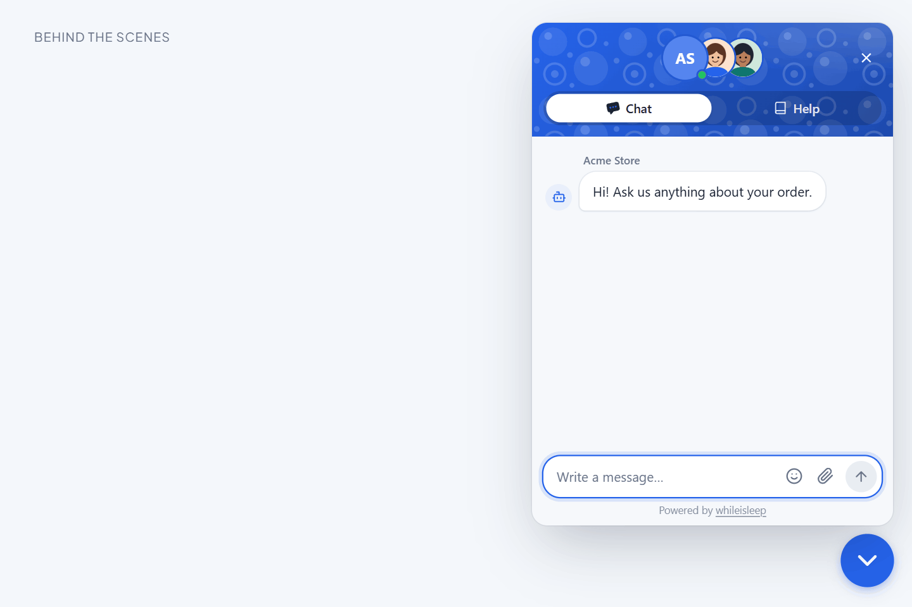
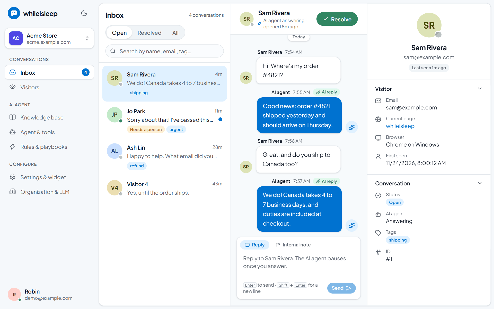
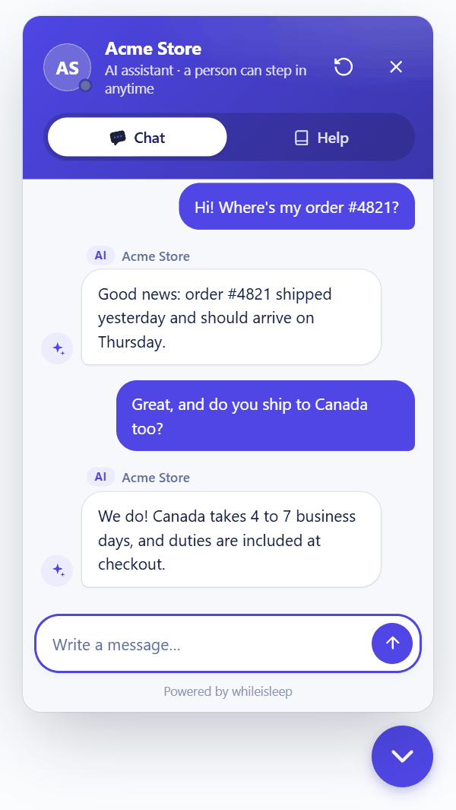
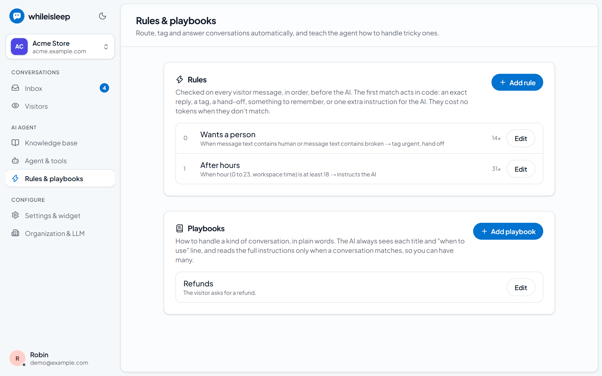
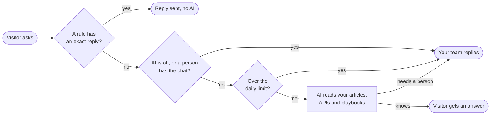

<div align="center">


# whileisleep

**AI answers. While you sleep.**

Open-source customer chat with an AI agent that answers from your own data,<br>
and only wakes you for the chats that need a human.

[See it work](#see-it-work) · [Explore](#explore) · [How it answers](#how-it-answers) · [Try it](#try-it-in-5-minutes) · [Docs](#docs)

</div>

## See it work

A visitor asks. The agent checks your rules, looks up real data, and replies.

**Not just text:** with [A2UI](https://a2ui.org), the agent can put forms and buttons right in the chat, so visitors fill in and click instead of typing it all out.



## The inbox

Every conversation in one place. Read what the AI said, take over any chat, or add a note for your team.

<picture>
  <source media="(prefers-color-scheme: dark)" srcset="docs/images/inbox-dark.png">
  
</picture>

## Explore

*Click to open.*

<details>
<summary><b>💬 The widget your visitors see</b></summary>
<br>

One script tag on your site, in one of 16 colors. Visitors chat or search your help center without leaving the page.



</details>

<details>
<summary><b>⚡ Rules and playbooks</b></summary>
<br>

**Rules** run before the AI: send an exact reply, add a tag, or hand off to a person.
**Playbooks** are plain-language instructions the AI follows for tricky cases, like refunds.



</details>

<details>
<summary><b>🔌 Answers from your own systems</b></summary>
<br>

- **Help center:** write articles once; visitors read them and the AI answers from them.
- **Your APIs:** order status, stock, product search. The agent looks facts up instead of guessing.
- **MCP servers:** connect one and choose which of its tools the agent may use.
- **Bring your own LLM:** your OpenRouter key and the model you pick.

</details>

<details>
<summary><b>👀 Live visitors</b></summary>
<br>

See who is on your site and which page they are on, and message them first. Messages and typing show up as they happen.

</details>

<details>
<summary><b>🔒 Safe by default</b></summary>
<br>

- Tools that return someone's data need an identity verified by your server.
- LLM keys and tool credentials are encrypted in the database.
- Messages and AI replies have rate limits and daily caps.

</details>

## How it answers

The cheapest way to answer goes first. The AI is used only when it is needed.



## Try it in 5 minutes

You need Docker, Node.js and pnpm. From a clone of this repo:

```sh
cp backend/.env.example backend/.env
docker compose -f backend/docker-compose.yaml up -d --build
cp frontend/.env.example frontend/.env
pnpm --dir frontend install
pnpm --dir frontend dev
```

Open <http://localhost:3004>, create an account, and add your OpenRouter key under **Organization & LLM**.

## Docs

| I want to… | Read |
| --- | --- |
| Run it on my own server | [Deploy on a VM (before your Maggi is ready 🍜)](docs/deploy-vm.md) |
| Add the widget and identify my users | [How it works](docs/how-it-works.md) |
| Know why it is built this way | [Decisions](docs/decision.md) |
